

  

<h1 align="center">Journify — Reflect & Discover Yourself</h1>

<strong>From a conversation at Collision to a calm, full-stack journaling experience.</strong>

  A visual case study in product thinking, design collaboration, user feedback, and end-to-end engineering.

  

<strong>Product engineering</strong> · <strong>Full-stack development</strong> · <strong>Human-centred design</strong> · <strong>Cloud deployment</strong>

---

### At a glance

| | |
| :-- | :-- |
| **The product** | A Zen-inspired digital journal for reflection, mood tracking, and consistent writing habits |
| **My role** | Led full-stack development, from core product functionality through deployment |
| **Collaboration** | Worked with a UI/UX designer and incorporated feedback from user testing |
| **What I built** | Journal editing, application state, account and data workflows, insights views, and responsive experiences |
| **Core stack** | React, Vite, BlockNote, Node.js, Express, MongoDB, Mongoose, AWS |
| **Case-study focus** | Translating an idea into software, navigating trade-offs, and improving the experience through iteration |

> **About this case study:** This repository documents the development of Journify, rather than hosting its application source. The architecture and deployment details below describe the implementation recorded in the original project documentation; a currently operating live deployment has not been independently verified.

## Table of contents

1. [Meet Journify](#1-meet-journify)
2. [The Story Behind Journify](#2-the-story-behind-journify)
3. [My Role & Contributions](#3-my-role--contributions)
4. [Understanding the Users](#4-understanding-the-users)
5. [From Concept to Design](#5-from-concept-to-design)
6. [Exploring Journify](#6-exploring-journify)
7. [Behind the Scenes: Building Journify](#7-behind-the-scenes-building-journify)
8. [Engineering Challenges & Solutions](#8-engineering-challenges--solutions)
9. [Feedback, Outcomes & Learnings](#9-feedback-outcomes--learnings)
10. [The Road Ahead](#10-the-road-ahead)

---

## 1. Meet Journify

**Writing about your day should feel like a moment of calm, not another task to complete.**

Journify began with that simple idea. We wanted to create a place where people could write freely, pause to reflect, and look back on how they were feeling over time. The experience combines the flexibility of a block-based editor with a quieter, more intentional visual language.

Rather than trying to be an all-purpose productivity workspace, the product was designed around a narrower goal: **make it easier to return to journaling regularly and enjoy the process.**

The original product concept brought several experiences together:

- **Express yourself:** Write entries using a flexible, Notion-style editor with formatting and slash commands.
- **Find your focus:** Use a distraction-reduced writing mode and optional Zen music.
- **Start when words are hard:** Choose from journaling prompts.
- **Notice patterns:** Record moods and explore visual summaries of entries and journaling activity.
- **Make it a habit:** Revisit past entries through calendar views and track journaling streaks.

These features are documented in the original case study. The sections below explain the thinking and engineering behind them, not a claim that a public live demo is available today.

## 2. The Story Behind Journify

The idea for Journify came from an unexpected conversation at **Collision Conference in Toronto**, where I met Candice, a UI/UX designer. We found a shared interest in mindfulness and personal journaling, along with a feeling that the tools we had encountered did not always make reflection feel welcoming.

That conversation led to a bigger question:

> **What if a journal could offer the flexibility of a modern digital workspace while still feeling peaceful and personal?**

We imagined a simple, beautiful environment that encouraged people to come back—not because it demanded productivity, but because the experience itself felt worthwhile. Notion's block-style editing offered one useful interaction model. The challenge was to adapt that flexibility for a much more focused journaling product.

  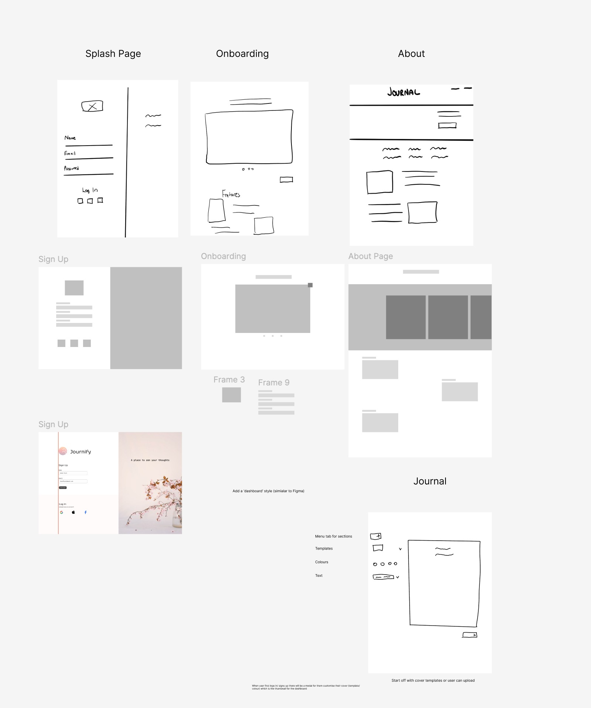

<em>Early ideation material preserved from the original project.</em>

Our early product goals were to support regular reflection, help people record how they felt, and create an experience that appealed to people interested in mindful living. These were **design goals**, not measured health outcomes.

### From idea to delivery

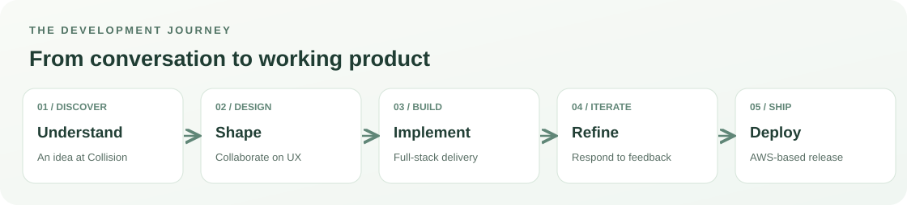

One of my most valuable lessons from this project was that good software development rarely moves in a straight line. Ideas become screens, screens reveal technical constraints, and feedback changes what needs attention next.

## 3. My Role & Contributions

I led the **full-stack implementation of Journify**, working across the parts of the application that users see and the services that support them.

My role was not just to connect a design to an API. I had to make individual pieces work as a coherent experience: the editor, journal data, authentication flows, visual insights, navigation, responsive behaviour, and deployment.

### What I owned

| Area | My contribution |
| :-- | :-- |
| **Product implementation** | Turned the product vision and design direction into interactive application features |
| **Frontend experience** | Built the React interface, journal editing experience, navigation, and responsive behaviour |
| **Application behaviour** | Managed journal state, data fetching, and updates across the writing experience |
| **Backend and data** | Implemented API and data workflows using Node.js, Express, MongoDB, and Mongoose |
| **Authentication** | Worked through JWT-based authentication, cookies, and password handling |
| **Delivery** | Deployed the documented frontend and backend using AWS services |
| **Iteration** | Responded to technical friction and user feedback with changes to the product |

### What made the collaboration valuable

Working with a designer meant thinking beyond whether a feature technically worked. I needed to understand **what the experience was intended to feel like**, explain where engineering constraints mattered, and find ways to preserve the design intent without sacrificing usability.

User feedback added another layer. The work was not finished when a screen looked right; it had to behave well when people actually used it.

That combination—understanding a need, communicating across roles, making implementation decisions, and owning delivery—is also how I approach customer-facing product engineering.

## 4. Understanding the Users

A journaling application has a particular challenge: people are often using it to think, slow down, and express themselves. Small interruptions can matter more here than they might in a conventional business dashboard.

The original project describes **multiple rounds of user testing** and feedback on the writing experience, visual design, focus mode, and ambient music. The research material below is retained from that work.

### Exploring reactions and expectations

  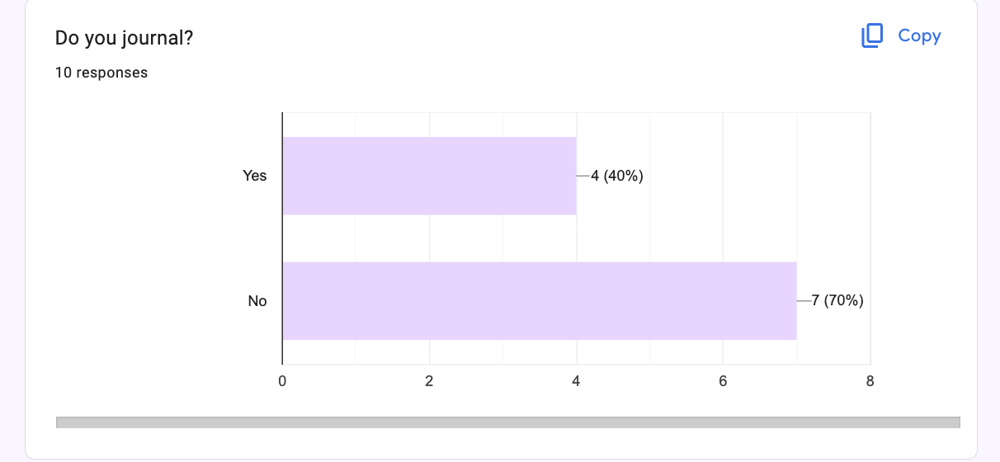
  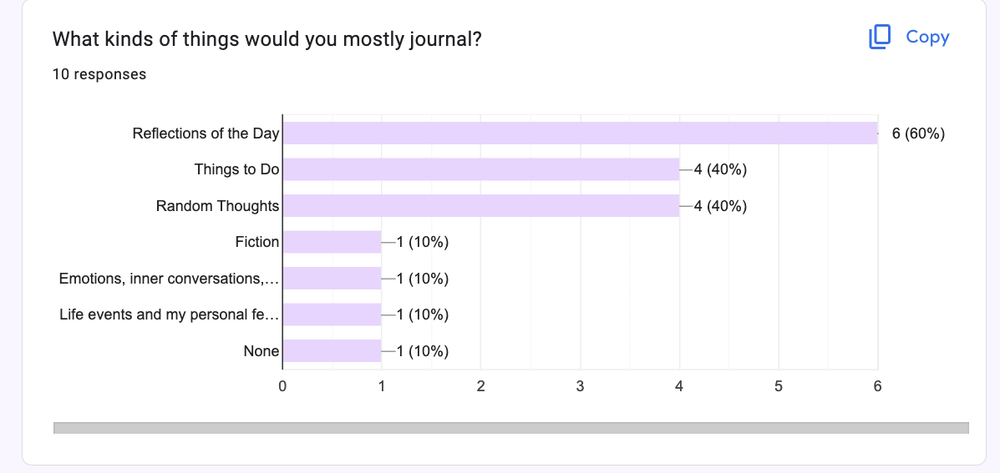

  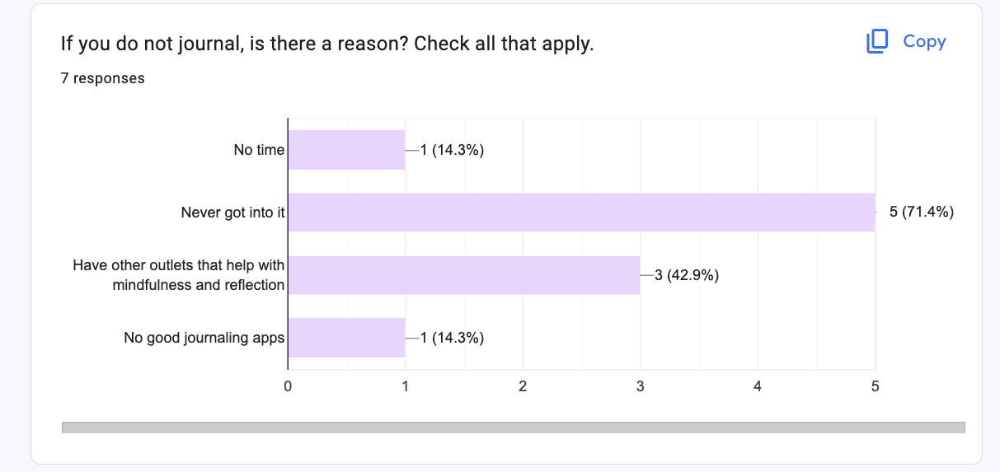
  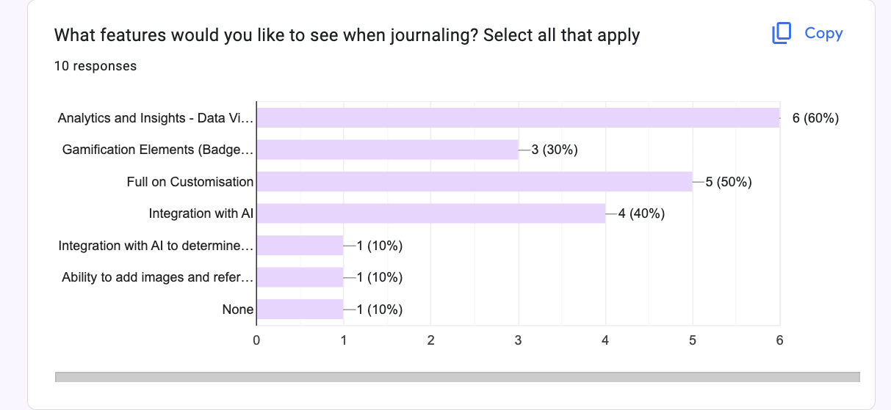

<em>Research and feedback artifacts from the original documentation.</em>

Three themes stood out in the documented feedback:

**The environment mattered.** People responded positively to the calm interface and focus-oriented features. That reinforced the decision to keep the visual design restrained instead of crowding the screen with controls.

**Editing needed to feel natural.** Feedback on the block-based editor pointed to responsiveness and formatting. Those observations aligned with the technical challenge of avoiding disruptive re-renders while typing.

**Consistency built confidence.** Feedback about colours and iconography encouraged refinement of details that make the product feel like one experience rather than disconnected components.

We did not document a reliable sample size, formal satisfaction score, or retention improvement, so those results are presented as qualitative feedback rather than quantified research findings.

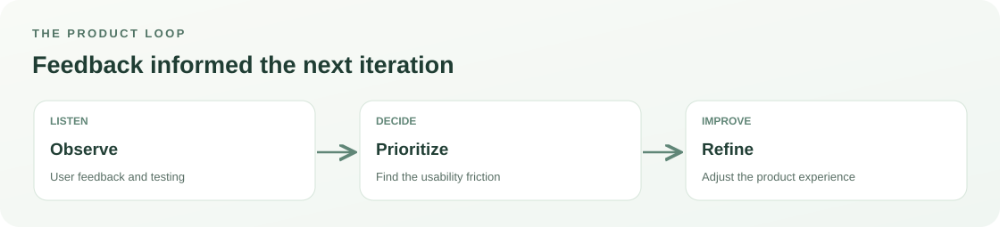

The practical lesson was simple: **feedback is most useful when it changes a specific product decision.**

## 5. From Concept to Design

The design direction was rooted in a calm, Zen-inspired atmosphere: a gentle palette, clear typography, generous spacing, and interfaces that supported writing without competing for attention.

This was a collaboration between design and engineering. The design work defined the character of the experience; my responsibility was to make it functional and consistent across devices.

### Finding the visual direction

  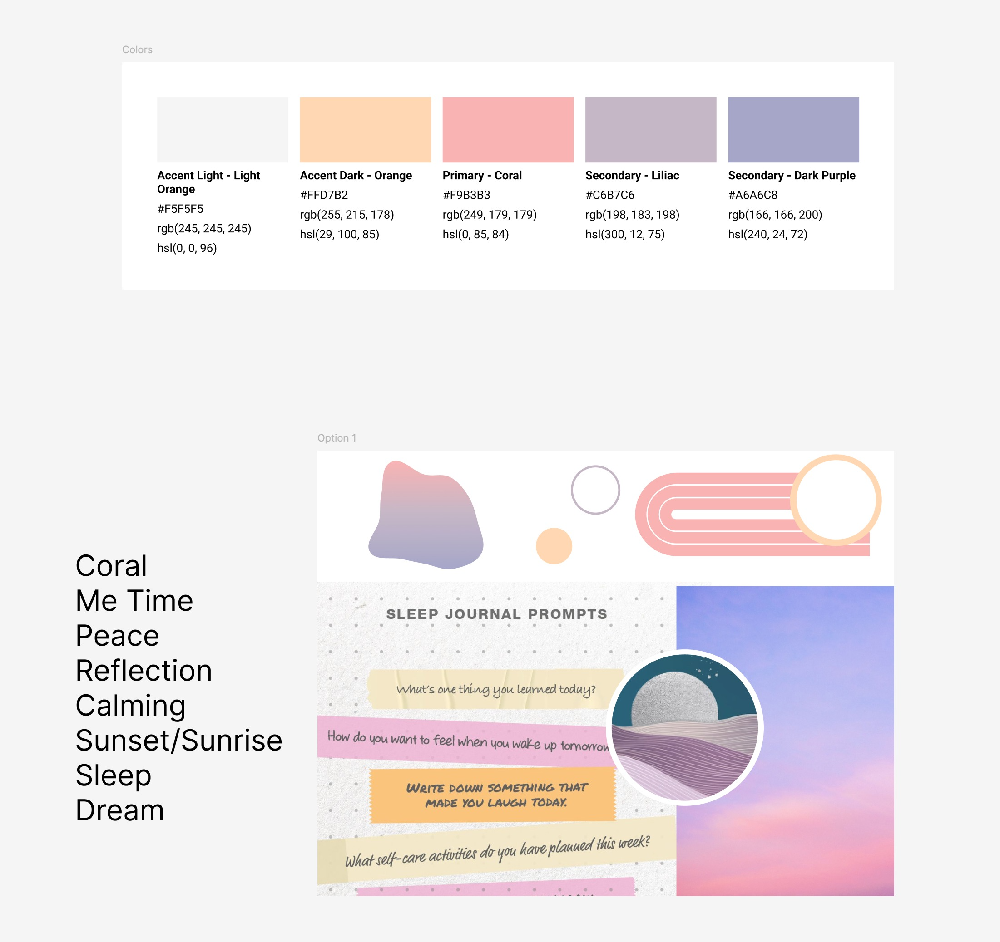

<em>The mood board established the atmosphere we wanted the product to communicate.</em>

### Making the experience readable

  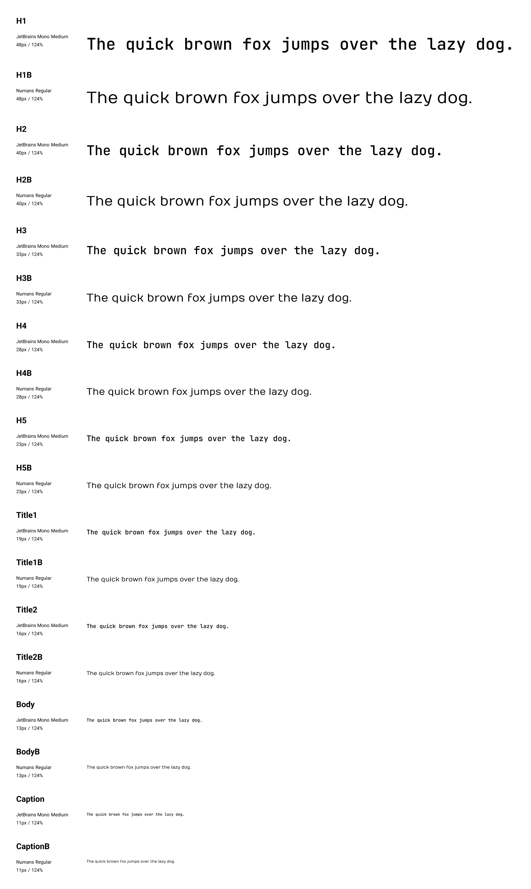

<em>Typography and visual hierarchy helped the journal feel approachable and readable.</em>

### Moving from early layouts to an interface

  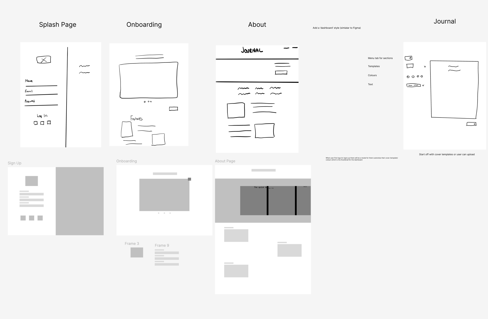

<em>Early layouts made it possible to explore the experience before every implementation detail was settled.</em>

The biggest design principle was not minimalism for its own sake. It was **giving the user's words the most important place on the screen**. Focus mode, restrained navigation, and thoughtful use of ambient elements all supported that idea.

## 6. Exploring Journify

The product brought together a number of connected experiences. Each solved a different part of the same problem: helping people start, continue, and revisit a journaling practice.

### A flexible place to write

A blank page can be freeing, but it can also feel limiting. Journify's Notion-style editor supported formatted content and slash commands, allowing an entry to take shape as the person wrote. The goal was flexibility without turning journaling into document administration.

The editor later became one of the most interesting engineering challenges in the project, because a good writing interface needs to respond naturally to each keystroke.

### Focus without isolation

An optional focus mode reduced distractions during writing. Zen music was included as another way to create a calmer environment, without requiring people to use it.

### Prompts to get started

Journaling prompts offered a starting point for moments when someone wanted to reflect but did not know what to write about. The intent was to reduce the effort needed to begin.

### Moods, history, and habits

Mood selection and visual summaries helped people revisit what they had recorded. Calendar views and streaks offered a way to find past entries and see how regularly they were journaling.

These features support reflection; they are not presented as a validated way to diagnose or predict mental health.

### Helping people find their way around

Onboarding was important because the application combined several unfamiliar interactions. The original implementation included a guided tour, which I adapted to work across screen sizes.

  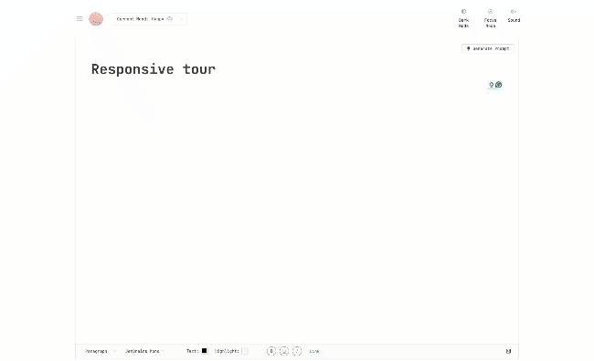

<em>Desktop onboarding walkthrough from the project.</em>

  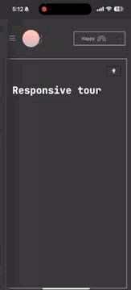

<em>The onboarding experience adapted for a smaller screen.</em>

**A note on visual evidence:** These are original project recordings. The documentation repository does not currently contain a complete verified screenshot set for every feature described above, so no substitute or AI-generated interface screens have been passed off as actual product captures.

## 7. Behind the Scenes: Building Journify

The interesting part of full-stack development is not simply using many technologies. It is making the different parts of a system work together in a way that users never have to think about.

For Journify, writing an entry involved more than displaying a text field. The interface needed to accept edits, keep application state in sync, communicate with the backend, and persist information so people could return to it later.

### The system at a glance

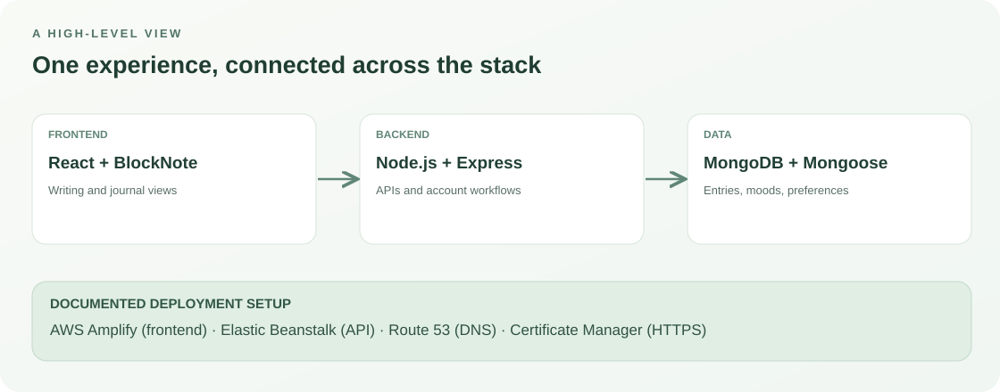

### Technology at a glance

  
  &nbsp;&nbsp;&nbsp;
  
  &nbsp;&nbsp;&nbsp;
  
  &nbsp;&nbsp;&nbsp;
  
  &nbsp;&nbsp;&nbsp;
  
  &nbsp;&nbsp;&nbsp;
  

**On the frontend**, React provided the interface, while Vite supported the development workflow. Ant Design, Tailwind CSS, and BlockNote helped build the visual components and editing experience. React Router handled navigation, and Axios was used for API requests.

**On the backend**, Node.js and Express supported application endpoints for journal entries and user data. MongoDB and Mongoose were used to model and store users, entries, moods, and preferences.

**For authentication**, the implementation documented JWTs, password hashing with bcrypt, and cookie handling. Those choices required attention to how browser requests and sessions behaved in development and production.

**For deployment**, the documented setup used AWS Amplify for the frontend, Elastic Beanstalk for the backend, Route 53 for DNS, and AWS Certificate Manager for HTTPS certificates.

The architecture diagram is a **conceptual overview** of the documented stack, not a production infrastructure audit or a claim about present-day service availability.

### Why these choices mattered

Rather than using a technology just because it was popular, I worked with tools that suited the problem: a flexible editor for expressive writing, a familiar component system for repeatable interfaces, backend APIs for application logic, and document-oriented storage for journal entries.

The more difficult decisions emerged where the tools did not behave as expected. Those challenges taught me more than the initial technology selection.

## 8. Engineering Challenges & Solutions

Three problems from this project stand out because each required more than following the original implementation plan.

### Challenge 01 — Keeping the editor responsive

**The problem.** While working with an early version of the block editor library, a controlled editor configuration could cause the editor to re-render on each change. Typing felt less natural than a writing product needed it to feel.

**The decision.** I moved the editor to an uncontrolled approach, introduced a reducer to manage journal data centrally, and used debounced updates to avoid triggering unnecessary work on every keystroke.

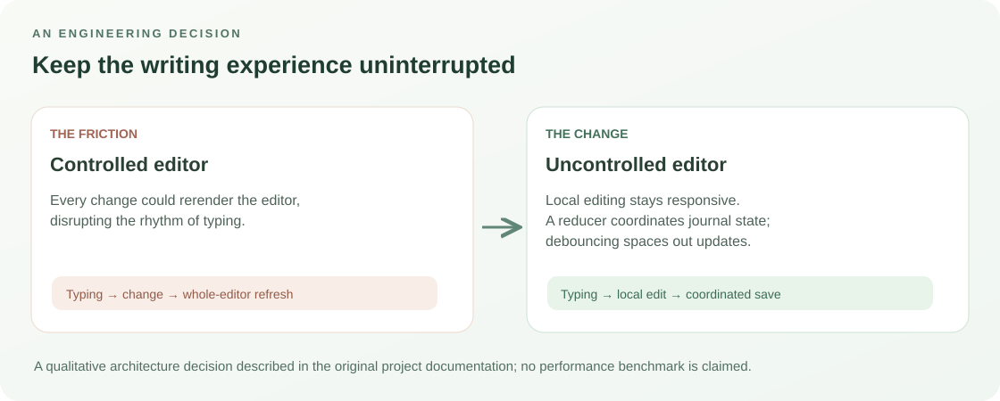

**Why it mattered.** The engineering solution supported the product goal. People should be thinking about what to write—not whether the interface will interrupt them.

**What this taught me.** A technically correct implementation can still be the wrong experience. When a library's default behaviour conflicts with the product, I need to understand the constraint and adapt the design of the solution.

### Challenge 02 — Authentication across environments

**The problem.** Working with token-based, cookie-based authentication introduced practical questions about browser behaviour and production configuration.

**The approach.** I worked through JWT-based sessions and cookie settings, including production-specific domain, HTTPS, HttpOnly, and SameSite configuration, while using bcrypt for password hashing.

**Why it mattered.** Authentication is part of the user's experience, even when it stays in the background. A smooth login flow depends on the frontend, backend, and browser agreeing on how session information is handled.

**What this taught me.** Security-related choices should be deliberate and tested across environments. This case study describes the historical implementation; it does not claim that a current independent security audit has been completed.

### Challenge 03 — Making onboarding work on mobile

**The problem.** The original Ant Design tour component did not respond well to smaller screens. Overriding styles created additional mobile layout issues.

**The decision.** Rather than continuing to patch the same behaviour, I redesigned the onboarding flow using the Reactour library, which better supported the interaction we needed.

**Why it mattered.** Onboarding only works if people can follow it on the device they are using. The desktop and mobile recordings in the product walkthrough show the resulting tour layouts.

**What this taught me.** Replacing a component can be more maintainable than accumulating workarounds, particularly when the original abstraction does not fit the experience.

### The common thread

Each challenge started as a technical issue, but the decision was guided by the same question: **what will make this experience work better for the person using it?**

That is the kind of problem-solving I value in product engineering—understand the underlying need, evaluate the trade-off, and make the smallest justified change that solves it.

## 9. Feedback, Outcomes & Learnings

Journify brought together product exploration, design collaboration, frontend development, backend services, and deployment into one end-to-end project.

### What was delivered

- A journaling application with flexible editing and reflection-focused features.
- Journal and account data workflows connected to a frontend experience.
- Mood and activity views intended to support reflection and journaling habits.
- A distraction-reduced writing environment and onboarding for desktop and mobile.
- A documented AWS deployment setup.
- Product refinements informed by feedback and implementation challenges.

### What changed through iteration

The original documentation records improvements to editor behaviour, additional formatting work, visual consistency, and the mobile tour experience. These are meaningful qualitative outcomes, but the project documentation does **not** establish precise performance gains, adoption figures, or changes in user retention.

### What I took away

**Start with the person, not the stack.** Understanding the intended experience helped me judge whether a particular implementation was actually appropriate.

**Be prepared to change the approach.** The editor and tour challenges were reminders that a plan is useful only while it continues to serve the product.

**Own the connections between systems.** Much of full-stack work happens between components, APIs, data, and deployment—not inside one neatly isolated feature.

**Communicate across disciplines.** Working with design and responding to user feedback helped me translate between what people wanted to experience and what the software needed to do.

The broader lesson was that delivering a working product requires both technical execution and judgment about what matters to the user.

## 10. The Road Ahead

The original roadmap identified several directions that could make Journify more useful over time. These are **ideas for future work**, not features claimed as shipped.

| Opportunity | The user need it could address |
| :-- | :-- |
| **Offline journaling** | Keep writing without a connection and synchronize later |
| **More personalization** | Let people adjust themes, fonts, and layouts to suit their preferences |
| **Better reflection insights** | Make it easier to understand patterns in writing and mood history |
| **Gentle reminders** | Help people return to journaling without making it feel like a chore |
| **Thoughtful AI assistance** | Explore optional prompts or summaries, with privacy and user control as primary constraints |

If revisiting the product, I would begin with the basic experience—reliability, writing flow, and whether people actually return to journal—before adding more advanced capabilities.

---

### Closing reflection

Journify started with a conversation about making reflection feel better. It became an opportunity to build a complete application, work closely with design, learn from users, and solve the kinds of engineering problems that rarely appear in a finished screenshot.

What I value most about the project is not the number of frameworks involved. It is the experience of taking an idea seriously enough to make it real—and adapting the implementation when the product needed something different.

**That is the kind of work I want to keep doing: understanding problems, collaborating with people, and delivering software that is useful in practice.**

---

Project case study and original visual assets are maintained in this repository. Application source code and live-demo status are not established by this documentation repository. Visual diagrams are explanatory illustrations based on the historical README.
